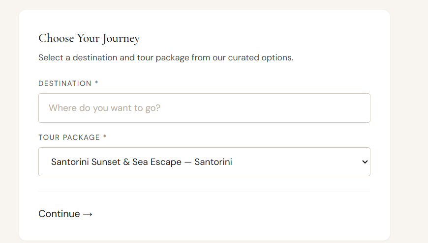
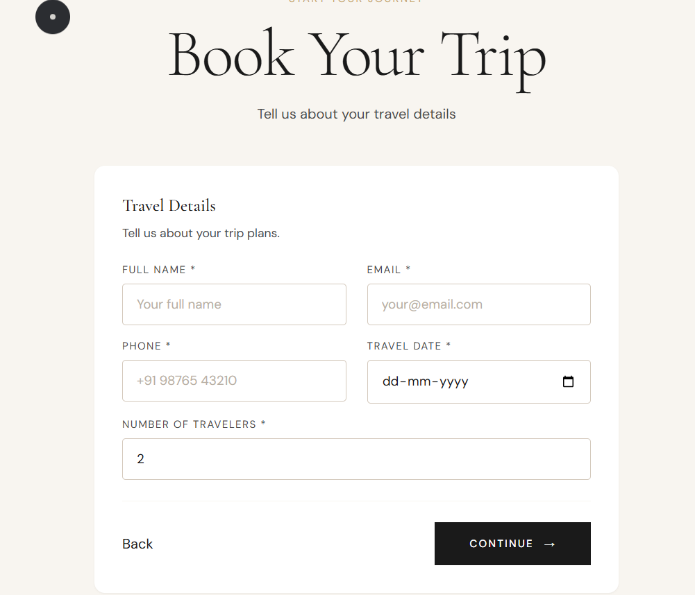
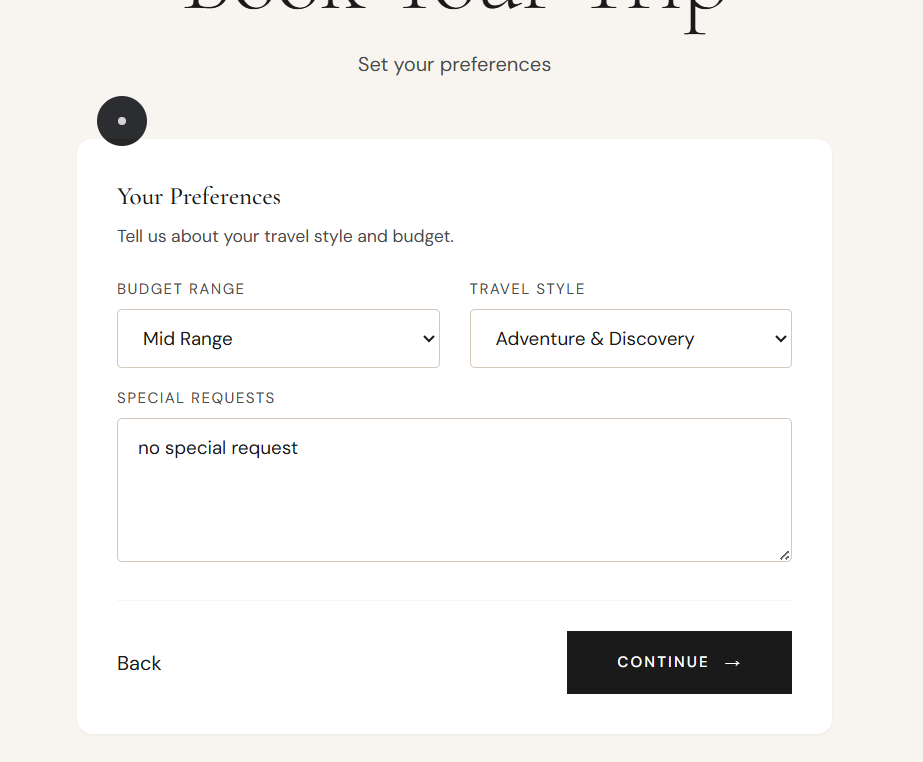
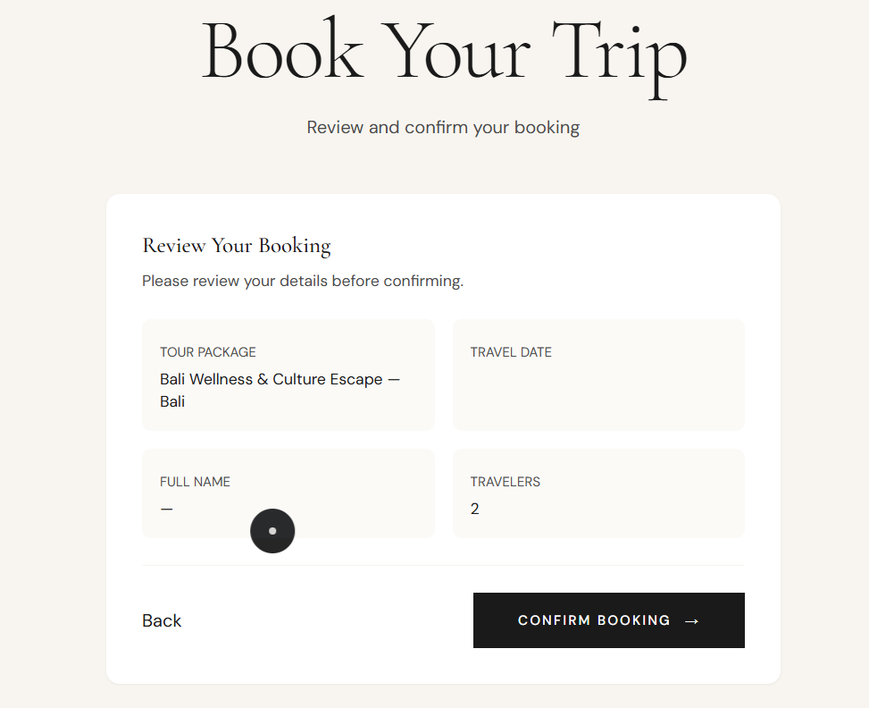
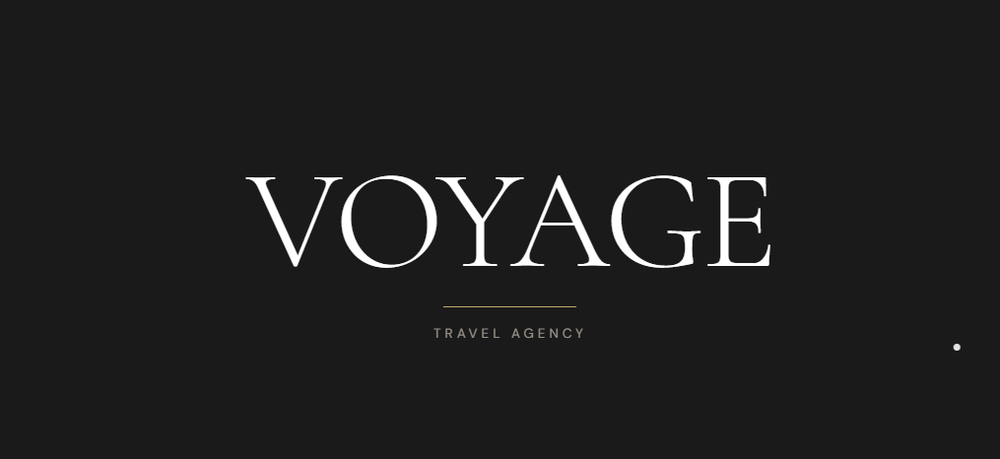
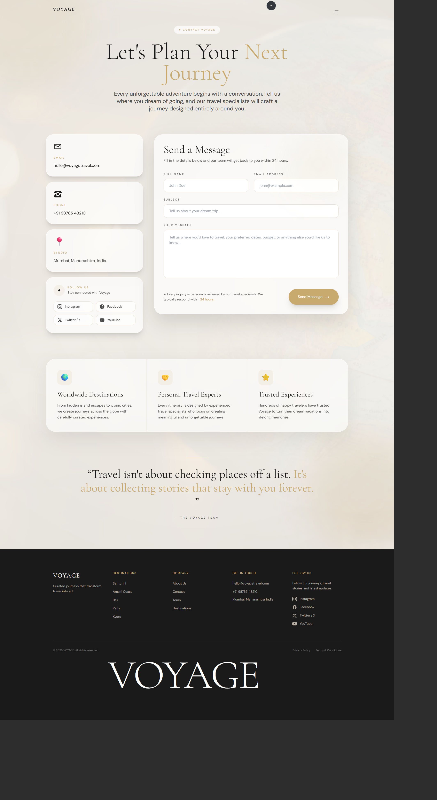

# VOYAGE Travel Agency


VOYAGE is a Django travel platform for curated journeys and personalised travel requests. It pairs an editorial, luxury-travel interface with the practical workflows needed to discover destinations, select a package, submit a booking, pay, receive an invoice, and manage the journey from an authenticated account.

## Product at a glance

VOYAGE serves two audiences:

- Travellers explore destinations, browse curated tours, select a package, submit travel details, review preferences, confirm a booking, access invoices, cancel journeys, and manage their profile.
- Administrators manage users, destinations, tours, bookings, invoices, revenue reporting, and the operational status of each journey.

The experience uses warm ivory surfaces, editorial serif headings, restrained champagne-gold accents, charcoal actions, thin borders, and generous spacing. The aim is a calm journey from inspiration to confirmation rather than a dense booking portal.

## Product journey

```text
Explore destinations
        ↓
Choose a destination and tour
        ↓
Enter traveller details
        ↓
Set preferences
        ↓
Review and confirm booking
        ↓
Complete payment
        ↓
Receive confirmation and invoice
        ↓
Manage, cancel, or review the journey
```

## Experience preview

### Explore

The destination catalogue introduces the brand with a large editorial heading and image-led destination cards.


### Choose a journey

The first booking step keeps the decision focused: select a destination, then select the relevant package.



### Traveller details

The booking form uses a calm two-column layout on larger screens and collapses for smaller devices.



### Preferences

Budget, travel style, and special requests are collected after the essential traveller information.



### Review

Before submission, the traveller sees the selected package and entered information in a compact confirmation view.



## Full product walkthrough

The repository includes the screenshots captured during the project review. GitHub renders these paths directly from the repository, so the documentation stays portable after a push or clone.

### Public website





### Account and booking flow




### Presentation

The 20-page product presentation is included as a repository artifact:

[Open the VOYAGE Curated Journeys presentation](docs/presentation/VOYAGE-Curated-Journeys.pdf)


## Core capabilities

### Customer experience

- Destination catalogue with destination detail pages.
- Curated tour packages with duration, pricing, capacity, and destination relationships.
- Package-aware **Book Now** routing.
- Multi-step booking flow with validation and clear required-field feedback.
- Personalised journey preferences for budget, travel style, accommodation, purpose, and special requests.
- Duplicate-submission protection for booking requests.
- Payment confirmation flow with loading overlay feedback.
- Journey archive and booking detail pages.
- Invoice PDF generation and downloadable invoice links.
- Booking cancellation with refund status messaging.
- Profile details, profile image, wishlist, and account security notifications.
- Branded 404 page for unknown routes and missing destination records.

### Admin experience

- Dashboard metrics for users, bookings, tours, destinations, and booking statuses.
- Booking search and filtering on the bookings page.
- Booking detail view with status management.
- Tour and destination CRUD workflows.
- Styled create and edit forms with consistent labels, validation, uploads, and action areas.
- Invoice list with working PDF open actions.
- Revenue chart populated from booking data.
- Branded administrator header and navigation.

## Email notifications

The application uses one shared VOYAGE email shell so customer and admin notifications have consistent typography, spacing, colors, footer information, and responsive behavior.

Active event coverage:

| Event | Recipient | Template | Trigger |
| --- | --- | --- | --- |
| New account | Customer | `emails/welcome.html` | Account creation signal |
| Successful login | Customer | `emails/login_alert.html` | Successful login |
| Booking request received | Customer | `emails/booking_confirmation.html` | Booking creation |
| New booking received | Admin | `emails/admin_booking_notification.html` | Booking creation |
| Payment/journey confirmed | Customer | `emails/booking_confirmed.html` | Successful payment |
| Invoice generated and sent | Customer | `emails/invoice.html` | Invoice send workflow |
| Journey cancellation | Customer | `emails/booking_cancelled.html` | Cancellation POST |
| Refund initiated | Customer | `emails/refund_initiated.html` | Paid booking cancellation |
| Contact acknowledgement | Customer | `emails/contact_auto_reply.html` | Contact form submission |

The repository also contains reusable templates for future verification, password reset, review, reminder, newsletter, and processed-refund workflows. They are documented in [EMAIL-EVENT-MATRIX.md](docs/EMAIL-EVENT-MATRIX.md) so dormant templates are not mistaken for active triggers.

## Technical structure

```text
travel-agency-project/
├── apps/
│   ├── accounts/       authentication, profiles, wishlist
│   ├── admin_panel/    dashboard and CRUD administration
│   ├── booking/        booking, payment, invoices, reviews
│   └── core/           destinations, tours, home, shared utilities
├── config/             Django settings, URLs, WSGI
├── media/              uploaded images and generated invoices
├── static/             CSS, JavaScript, images, loader assets
├── templates/          customer, admin, component, and email templates
├── docs/               product, wireframing, email, and presentation notes
├── db.sqlite3          local development database
└── manage.py
```

## Local setup

### Requirements

- Python 3.10 or newer
- A virtual environment
- SQLite for local development
- SMTP credentials or Django's console email backend for local email inspection

### Install and run

```powershell
py -m venv .venv
.\.venv\Scripts\Activate.ps1
py -m pip install -r requirements.txt
py manage.py migrate
py manage.py runserver
```

Open `http://127.0.0.1:8000/` for the customer site and `http://127.0.0.1:8000/admin-panel/` for the VOYAGE admin panel.

For local email development, use the console backend:

```powershell
$env:EMAIL_BACKEND = 'django.core.mail.backends.console.EmailBackend'
py manage.py runserver
```

## Useful verification commands

```powershell
py manage.py check
py manage.py test
py manage.py collectstatic --noinput
```

The email template set can be compiled through Django's template loader:

```powershell
py manage.py shell -c "from django.template.loader import get_template; import glob,os; [get_template('emails/'+os.path.basename(f)) for f in glob.glob('templates/emails/*.html')]; print('email templates compile successfully')"
```

## Documentation

- [Product Requirements Document](docs/PRD.md)
- [Wireframing and information architecture](docs/WIREFRAMES.md)
- [Email event matrix](docs/EMAIL-EVENT-MATRIX.md)
- [Presentation handoff](docs/presentation/README.md)
- [Contribution guide](CONTRIBUTING.md)

## Design principles

VOYAGE keeps the interface deliberately quiet:

- Inspiration comes from editorial typography and destination imagery.
- Forms use visible labels above controls and predictable spacing.
- Actions remain clear, with charcoal primary buttons and restrained secondary actions.
- Feedback appears at the moment of action through validation messages, branded loading overlays, confirmation states, and transactional email.
- Admin tools share the same design language without sacrificing operational density.

## Project status

This is an active project prototype. Before production deployment, configure a production secret key, disable debug mode, set explicit allowed hosts, use a production database and email provider, review uploaded-file storage, and add automated tests for payment idempotency and notification delivery.
